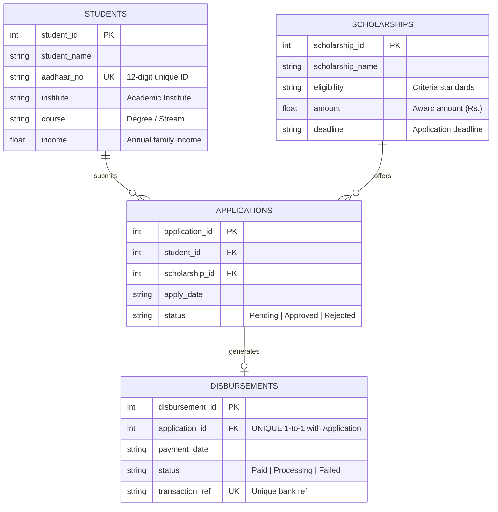

# Architecture, DBMS Concepts & Viva Guide

## 1. Project Statement & Relational Schema

### Problem Statement: 36. Scholarship Management System
The objective is to design, implement, and maintain a robust relational database management system for managing academic scholarships across educational institutes, tracking student eligibility, reviewing submissions, and monitoring verified fund disbursements.

### Core Relations (as specified)
1. **Students** (`student_id` PK, `student_name`, `aadhaar_no` UNIQUE, `institute`, `course`, `income`)
2. **Scholarships** (`scholarship_id` PK, `scholarship_name`, `eligibility`, `amount`, `deadline`)
3. **Applications** (`application_id` PK, `student_id` FK, `scholarship_id` FK, `apply_date`, `status`)
4. **Disbursements** (`disbursement_id` PK, `application_id` FK, `payment_date`, `status`, `transaction_ref`)

---

## 2. Entity-Relationship (ER) Architecture



### Cardinality & Structural Constraints
- **Students to Applications (1 : N)**: A registered student can apply for multiple scholarships, but can apply to each scholarship scheme only once (`UNIQUE(student_id, scholarship_id)`).
- **Scholarships to Applications (1 : N)**: A scholarship scheme can receive applications from multiple eligible students across various institutes.
- **Applications to Disbursements (1 : 0..1)**: An application produces at most one disbursement. A disbursement can only be recorded when the application decision is `Approved`.

---

## 3. Database Constraints & Integrity Rules

1. **Entity Integrity**:
   - Every primary key (`student_id`, `scholarship_id`, `application_id`, `disbursement_id`) is strictly non-null and automatically incremented (`AUTOINCREMENT`).
2. **Referential Integrity**:
   - Enforced via SQLite foreign keys (`PRAGMA foreign_keys = ON`) with `ON DELETE RESTRICT ON UPDATE CASCADE`. An application cannot reference a non-existent student or scholarship. A disbursement cannot reference a non-existent application.
3. **Domain Constraints**:
   - `CHECK(length(aadhaar_no) = 12)`: Ensures national identification numbers strictly adhere to the 12-digit specification.
   - `CHECK(income >= 0)`: Ensures family income cannot be negative.
   - `CHECK(amount > 0)`: Scholarship award must be a positive monetary figure.
   - `CHECK(status IN ('Pending', 'Approved', 'Rejected'))`: Enforces a finite-state machine for application decisions.
   - `CHECK(status IN ('Paid', 'Processing', 'Failed'))`: Enforces valid financial transaction states.
4. **Uniqueness Constraints**:
   - `aadhaar_no UNIQUE`: Eliminates duplicate student records.
   - `UNIQUE(student_id, scholarship_id)`: Prevents repeated applications for the same scheme by the same student.
   - `transaction_ref UNIQUE`: Prevents reconciliation errors and double payments.
5. **SQL Injection Defense**:
   - All backend queries strictly utilize parameterized queries (`?` place-holders) in SQLite rather than string concatenation.

---

## 4. Normalization Analysis

- **First Normal Form (1NF)**: All attributes contain atomic, indivisible values. There are no repeating groups or multi-valued fields.
- **Second Normal Form (2NF)**: All tables are in 1NF and every non-prime attribute is fully functionally dependent on the entire primary key (no partial dependencies on composite keys).
- **Third Normal Form (3NF)**: All tables are in 2NF with no transitive functional dependencies ($X \rightarrow Y$ and $Y \rightarrow Z$ do not exist; all non-key attributes depend solely on the primary key).
- **Boyce-Codd Normal Form (BCNF)**: For every functional dependency $X \rightarrow Y$, $X$ is a super key.

---

## 5. Core SQL Queries Demonstrated in the Project

### A. Dashboard Aggregate Query (Cross-relation Summary)
```sql
SELECT 
    (SELECT COUNT(*) FROM students) AS students,
    (SELECT COUNT(*) FROM scholarships) AS scholarships,
    (SELECT COUNT(*) FROM applications) AS applications,
    (SELECT COUNT(*) FROM disbursements WHERE status = 'Paid') AS paid;
```

### B. Institute Performance & Allocation Report
Demonstrates multi-table `LEFT JOIN`, conditional aggregation (`CASE WHEN`), and `GROUP BY`:
```sql
SELECT s.institute,
       COUNT(DISTINCT s.student_id) AS total_students,
       COUNT(DISTINCT a.application_id) AS total_applications,
       COUNT(DISTINCT CASE WHEN a.status = 'Approved' THEN a.application_id END) AS approved_applications,
       COUNT(DISTINCT CASE WHEN a.status = 'Pending' THEN a.application_id END) AS pending_applications,
       COUNT(DISTINCT CASE WHEN a.status = 'Rejected' THEN a.application_id END) AS rejected_applications,
       COALESCE(SUM(CASE WHEN d.status = 'Paid' THEN sc.amount ELSE 0 END), 0) AS total_disbursed
FROM students s
LEFT JOIN applications a ON a.student_id = s.student_id
LEFT JOIN scholarships sc ON sc.scholarship_id = a.scholarship_id
LEFT JOIN disbursements d ON d.application_id = a.application_id
GROUP BY s.institute
ORDER BY total_students DESC;
```

### C. Identifying Approved Unpaid Applications for Disbursement
Demonstrates subqueries with `NOT IN` set operation:
```sql
SELECT a.application_id, s.student_name, s.institute, sc.scholarship_name, sc.amount
FROM applications a
JOIN students s USING(student_id)
JOIN scholarships sc USING(scholarship_id)
WHERE a.status = 'Approved' 
  AND a.application_id NOT IN (SELECT application_id FROM disbursements)
ORDER BY a.application_id DESC;
```

---

## 6. Technical Stack & Deployment

- **Backend**: FastAPI (Python 3.11+) with ASGI/WSGI Universal compatibility (`a2wsgi`).
- **Database Engine**: SQLite 3 with WAL mode, foreign keys enabled (`PRAGMA foreign_keys = ON`).
- **Database Driver**: Python standard library `sqlite3` with custom `Row` dictionary and attribute wrapper.
- **Frontend 1 (Vercel)**: Vanilla JS, CSS3, Single Page Application with asynchronous REST communication.
- **Frontend 2 (Render / Local)**: Jinja2 server-rendered templates for administrative controls.
- **Hosting Platforms**:
  - Render: Hosts the FastAPI Python backend service.
  - Vercel: Hosts the static frontend dashboard with instant CDN distribution.

---

## 7. Viva Voce Preparation Guide

**Q1: Why did you split the data into 4 tables instead of storing everything in one flat table?**  
*Answer:* "Storing everything in one table creates insertion, update, and deletion anomalies. For example, if a scholarship has no applicants yet, we couldn't store it without dummy student data. Normalizing into four tables satisfies 3NF/BCNF, eliminates redundancy, and ensures data integrity."

**Q2: How does the system prevent a student from applying twice to the same scholarship?**  
*Answer:* "We enforce a composite unique constraint in the `applications` table: `UNIQUE(student_id, scholarship_id)`. Any attempt to insert a second application for the same combination will trigger an integrity constraint error, which is caught gracefully."

**Q3: How are foreign keys and ACID transactions enforced in SQLite?**  
*Answer:* "By default, SQLite disables foreign key enforcement for backward compatibility. In our connection utility (`backend/database.py`), we explicitly execute `PRAGMA foreign_keys = ON` on every connection. SQLite provides atomic transactions with write-ahead logging (WAL) mode for concurrency."

**Q4: Can a disbursement exist without an approved application?**  
*Answer:* "No. First, `disbursements.application_id` is a foreign key pointing to `applications.application_id`. Second, our business logic and queries only permit disbursement creation when `applications.status = 'Approved'` and enforce that an application cannot be paid more than once via `UNIQUE(application_id)`."
